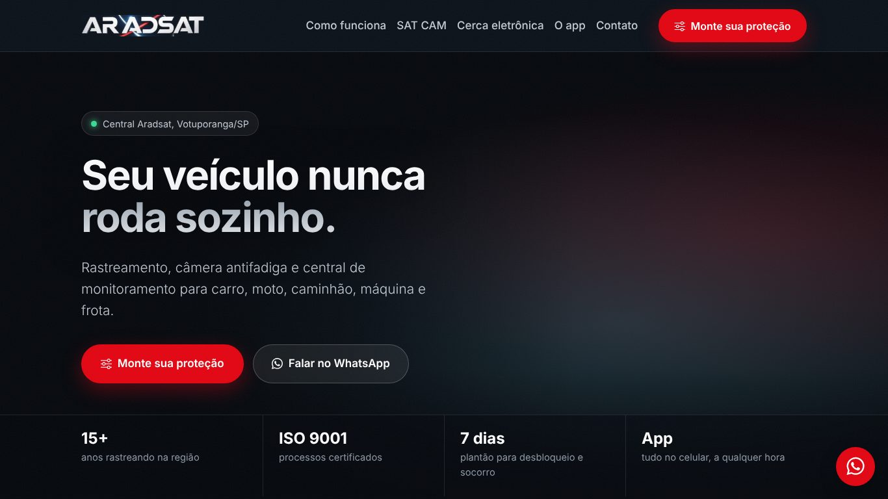
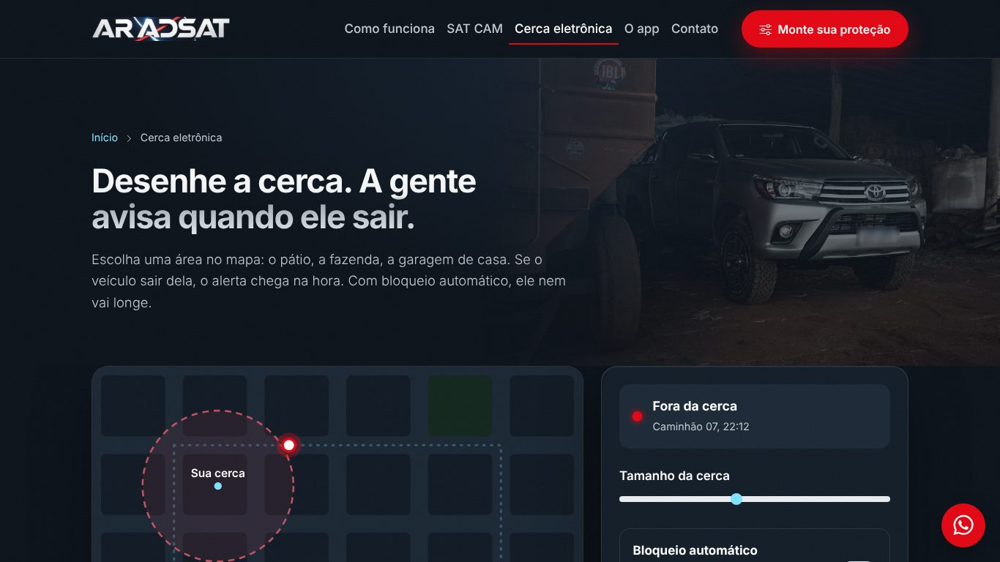

# Aradsat — site institucional

Site da **Aradsat Rastreamento**, empresa de rastreamento veicular de Votuporanga/SP.
Refeito do zero para substituir o antigo WordPress.

**Ao vivo:** https://leocasteletti.github.io/aradsat-site/



## Páginas

| Página | Destaque |
|---|---|
| `index.html` | Hero com cidade 3D em WebGL, serviços, tipos de veículo, app e contato |
| `satcam.html` | Demonstração da câmera antifadiga usando a webcam do visitante |
| `cerca-eletronica.html` | Simulador de cerca eletrônica com alerta e bloqueio |
| `orcamento.html` | Assistente de 5 perguntas que monta a mensagem de orçamento no WhatsApp |



## Decisões

- **100% estático:** HTML, CSS e JavaScript, sem build e sem back-end
- **Sem preços no site:** o contato acontece pelo WhatsApp
- **CSS só em arquivo** (`assets/css/style.css`), sem estilos inline
- **JavaScript por página** (`assets/js/`), carregado só onde é usado
- Testado de 320 px a 1920 px

## Rodando

Abrir `index.html` no navegador. A demonstração da SAT CAM precisa de HTTPS (ou `localhost`) para acessar a câmera:

```bash
python -m http.server 8000
```

## Stack

HTML · CSS · JavaScript · Bootstrap 5 · Bootstrap Icons · WebGL

---

Marca, logotipo e fotos pertencem à Aradsat Rastreamento.
